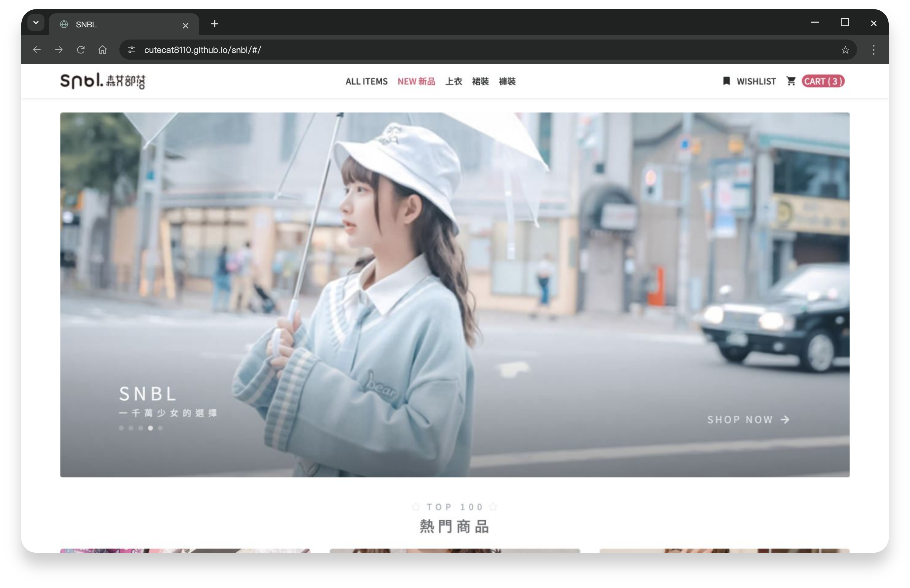

# SNBL - 電商網站


> 以「少女時尚」為主題的電商網站，提供商品瀏覽、收藏、購物車、下單與後台管理。



## 📋 專案概述

此專案旨在提升 Vue Options API 技術熟練度，從企劃、設計到前端皆獨立開發。內容涵蓋網站架構、購物流程規劃、RWD 網頁設計、切版與動效，以及六角學院 API 串接。

**[Demo](https://cutecat8110.github.io/snbl/)** · [API 文件](https://github.com/hexschool/vue3-course-api-wiki/wiki)

## 🔨 核心技術

<table>
  <tbody>
    <tr>
      <td>
        <a href="https://vuejs.org/" >
          Vue 3
        </a>
      </td>
      <td>JavaScript 框架</td>
    </tr>
    <tr>
      <td>
        <a href="https://github.com/imcvampire/vue-axios" >
          Vue Axios
        </a>
      </td>
      <td>HTTP 請求工具</td>
    </tr>
    <tr>
      <td>
        <a href="https://getbootstrap.com/" >
          Bootstrap 5
        </a>
      </td>
      <td>CSS/HTML 框架</td>
    </tr>
  </tbody>
</table>

## 🛠️ 擴展套件

<table>
  <tbody>
    <tr>
      <td>
        <a href="https://github.com/developit/mitt">
          mitt
        </a>
      </td>
      <td>處理組件間事件交互</td>
    </tr>
    <tr>
      <td>
        <a href="https://sweetalert2.github.io/">
          SweetAlert 2
        </a>
      </td>
      <td>可定製訊息彈框</td>
    </tr>
    <tr>
      <td>
        <a href="https://github.com/ankurk91/vue-loading-overlay">
          Vue Loading Overlay
        </a>
      </td>
      <td>loading 效果組件</td>
    </tr>
    <tr>
      <td>
        <a href="https://swiperjs.com/">
          Swiper
        </a>
      </td>
      <td>輪播/滑動組件</td>
    </tr>
    <tr>
      <td>
        <a href="https://vee-validate.logaretm.com/v4/">
          VeeValidate
        </a>
      </td>
      <td>表單驗證庫</td>
    </tr>
    <tr>
      <td>
        <a href="https://fontawesome.com/">
          Font Awesome
        </a>
      </td>
      <td>大量開源向量圖標</td>
    </tr>
    <tr>
      <td>
        <a href="https://fonts.google.com/icons">
          Material Design Icons
        </a>
      </td>
      <td>Google 開源圖標</td>
    </tr>
  </tbody>
</table>

## 🌸 啟動指南

使用 Node 16.20.2／npm 8：

```sh
npm ci
npm run serve
```

開啟 `http://localhost:8080/snbl/`。可用 `.env.local` 的 `VUE_APP_API`、`VUE_APP_PATH` 設定自己的課程 API。

## 使用說明

前台可直接體驗；後台需管理帳號，不提供公開帳密。訂單與付款為練習流程，不會實際扣款或出貨；請勿填入個人資訊。
